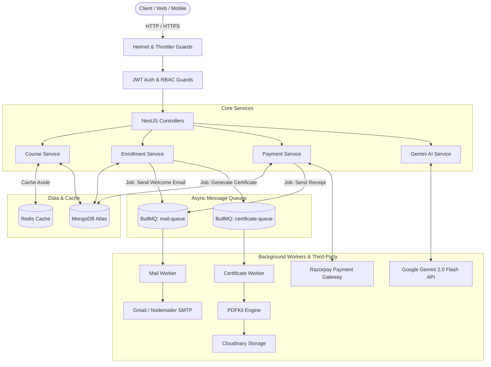

# 🎓 Enterprise LMS Backend (Learning Management System)

A production-grade, scalable Learning Management System (LMS) backend built with **NestJS**, **MongoDB**, **Redis**, **BullMQ**, and **Google Gemini AI**.

Designed with clean architecture, enterprise security, asynchronous background job processing, automated payment lifecycles, PDF generation, and generative AI capabilities.

---

## 🌟 Key Features

### 🔐 Authentication & Role-Based Access Control (RBAC)
- **JWT Authentication** with password hashing using `bcrypt`.
- **Granular Roles:** `ADMIN`, `TEACHER`, and `STUDENT`.
- Custom decorators (`@Roles()`) and guards (`AuthGuard`, `RolesGuard`) for endpoint security.

### 📚 Course Management & Query Engine
- Modular curriculum architecture: **Courses ➔ Modules ➔ Lessons** (embedded subdocuments).
- Advanced query engine featuring pagination, search, price/level filtering, and regex sanitization.
- Object-level authorization (BOLA/IDOR protection) ensuring teachers only modify their own courses.

### 📈 Enrollment Engine & Progress Tracking
- Idempotent enrollment checks preventing duplicate purchases.
- Lesson completion tracking with dynamic percentage calculation.
- Automated course completion detection triggering asynchronous workflows.

### 💳 Payment Lifecycle & Automated Webhooks (Razorpay)
- Two-step payment flow: Order creation and HMAC-SHA256 signature verification.
- Transaction state machine: `PENDING` ➔ `SUCCESS` / `FAILED`.
- Automated post-payment enrollment and branded HTML email receipts via background queues.

### 📬 Asynchronous Job Queues (BullMQ & Redis)
- **Email Queue (`mail-queue`):** Asynchronous delivery of welcome emails and payment receipts using Nodemailer with responsive HTML templates.
- **Certificate Queue (`certificate-queue`):** Asynchronous generation of verification-backed PDF certificates upon 100% course completion.

### 📜 Dynamic PDF Certificate Engine
- Dynamic vector PDF generation using `PDFDocument` (PDFKit) featuring custom borders, typography, student name, and unique verification tokens.
- Automated stream upload to **Cloudinary** media storage.
- Public certificate verification endpoint (`GET /certificate/verify/:id`).

### 🤖 Generative AI Engine (Google Gemini 2.0 Flash)
- **Curriculum Generator (`POST /ai/generate-curriculum`):** Allows teachers to generate full course syllabi (modules, lessons, and summaries) using structured JSON output from Gemini.
- **AI Course Assistant (`POST /ai/course/:id/ask`):** Context-aware Q&A teaching assistant for enrolled students, dynamically feeding course metadata and module syllabus into Gemini prompt context.

### ⚡ Caching & Performance
- **Redis Cache-Aside Pattern:** Ultra-low latency course listings cached via `ioredis`.
- **Proactive Cache Busting:** Automatically invalidates cached catalog on course create, update, or delete.

### 🛡️ Production Security & Architecture
- **Rate Limiting:** IP-level throttling with `@nestjs/throttler` (strict login/register limits).
- **HTTP Hardening:** Security headers using `helmet`.
- **Global Filters & Interceptors:** Centralized exception handling (`AllExceptionsFilter`) and uniform API response envelopes (`TransformInterceptor`).
- **Interactive Documentation:** Fully documented with **Swagger (OpenAPI 3.0)** and Bearer auth support.

---

## 🏗️ System Architecture



---

## 🛠️ Tech Stack

- **Runtime & Framework:** Node.js, TypeScript, [NestJS](https://nestjs.com/)
- **Database & ODM:** [MongoDB](https://www.mongodb.com/), [Mongoose](https://mongoosejs.com/)
- **In-Memory Store & Queues:** [Redis](https://redis.io/) (ioredis), [BullMQ](https://bullmq.io/)
- **AI / LLM:** Google Gemini API (`@google/genai`)
- **Payments:** Razorpay API (`razorpay`)
- **Storage & Assets:** Cloudinary (`cloudinary`)
- **Documents & PDF:** PDFKit (`pdfkit`)
- **Email:** Nodemailer (`nodemailer`)
- **API Documentation:** Swagger / OpenAPI (`@nestjs/swagger`)
- **Containerization:** Docker & Docker Compose

---

## 🚀 Getting Started

### 1. Prerequisites
- [Node.js](https://nodejs.org/) (v18+)
- [Docker](https://www.docker.com/) (for Redis)
- MongoDB instance (Local or MongoDB Atlas)

### 2. Clone the Repository
```bash
git clone https://github.com/your-username/lms-backend.git
cd lms-backend
```

### 3. Install Dependencies
```bash
npm install
```

### 4. Configure Environment Variables
Create a `.env` file in the root directory:

```env
# Application
PORT=3000
NODE_ENV=development

# Database
MONGODB_URL=mongodb+srv://<username>:<password>@cluster.mongodb.net/lms?retryWrites=true&w=majority

# JWT
JWT_SECRET=your_super_secret_jwt_key
JWT_EXPIRES_IN=7d

# Redis
REDIS_HOST=localhost
REDIS_PORT=6379

# Google Gemini AI
GEMINI_API_KEY=your_gemini_api_key
GEMINI_MODEL=gemini-2.0-flash

# Razorpay
RAZORPAY_KEY_ID=your_razorpay_key_id
RAZORPAY_KEY_SECRET=your_razorpay_secret

# Cloudinary
CLOUDINARY_CLOUD_NAME=your_cloud_name
CLOUDINARY_API_KEY=your_api_key
CLOUDINARY_API_SECRET=your_api_secret

# Mail (SMTP)
MAIL_HOST=smtp.gmail.com
MAIL_PORT=587
MAIL_USER=your_email@gmail.com
MAIL_PASS=your_app_password
MAIL_FROM="LMS Academy <noreply@lmsacademy.com>"
```

### 5. Start Redis with Docker
```bash
docker compose -f docker/docker-compose.yml up -d
```

### 6. Run the Application
```bash
# Development mode
npm run start:dev

# Production build
npm run build
npm run start:prod
```

---

## 📖 API Documentation (Swagger)

Once the application is running, navigate to:
```
http://localhost:3000/api
```

Use the **Authorize** button to test protected routes by pasting a valid Bearer JWT.

---

## 🧪 Core API Endpoints

### 🔐 Authentication
| Method | Endpoint | Description | Role |
|---|---|---|---|
| `POST` | `/auth/register` | Register a new user | Public |
| `POST` | `/auth/login` | Authenticate and obtain JWT | Public |

### 📚 Courses
| Method | Endpoint | Description | Role |
|---|---|---|---|
| `GET` | `/course` | List all courses (cached, paginated, filtered) | Public |
| `GET` | `/course/:id` | Get course details by ID | Public |
| `POST` | `/course` | Create a new course | Teacher, Admin |
| `PATCH` | `/course/:id` | Update course details | Teacher (Owner), Admin |
| `DELETE` | `/course/:id` | Delete course | Teacher (Owner), Admin |
| `PATCH` | `/course/:id/thumbnail` | Upload course thumbnail | Teacher (Owner), Admin |
| `GET` | `/course/instructor/analytics` | View revenue & enrollment stats | Teacher |

### 📈 Enrollment & Progress
| Method | Endpoint | Description | Role |
|---|---|---|---|
| `GET` | `/enrollment/my-courses` | Get logged-in user enrollments | Student |
| `POST` | `/enrollment/:courseId/complete-lesson` | Mark lesson complete & calculate progress | Student |

### 💳 Payments
| Method | Endpoint | Description | Role |
|---|---|---|---|
| `POST` | `/payment/create-order` | Create Razorpay order | Student |
| `POST` | `/payment/verify` | Verify payment signature & auto-enroll | Student |

### 🤖 Generative AI
| Method | Endpoint | Description | Role |
|---|---|---|---|
| `POST` | `/ai/generate-curriculum` | Generate course syllabus with Gemini | Teacher, Admin |
| `POST` | `/ai/course/:courseId/ask` | Context-aware AI Teaching Assistant | Student (Enrolled) |

### 📜 Certificates
| Method | Endpoint | Description | Role |
|---|---|---|---|
| `GET` | `/certificate/verify/:certificateId` | Publicly verify certificate validity | Public |

---

## 👨‍💻 Author

- **Ayush** — Full Stack / Backend Engineer
- LinkedIn: [Your LinkedIn Profile](https://linkedin.com/in/ayushsharma-dev)
- GitHub: [@your-username](https://github.com/Sharma-ayush-20)
